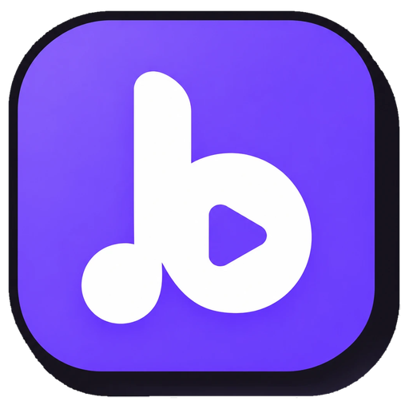
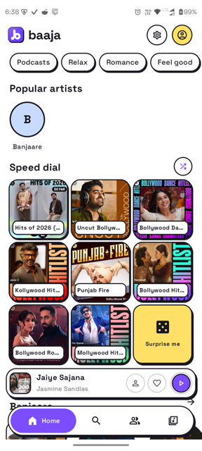
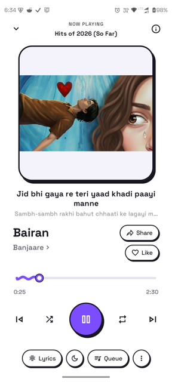
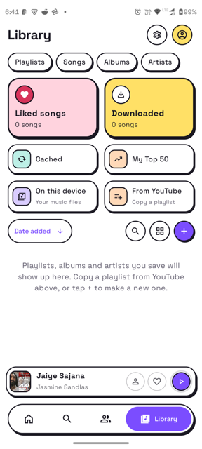
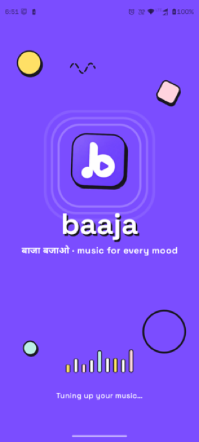

<div align="center">



# Baaja (बाजा)

### बाजा बजाओ. A free, ad-free YouTube Music client for Android with a bold, playful design.

[](https://github.com/harshaltiwari47-dot/Baaja/releases/latest)
[](https://github.com/harshaltiwari47-dot/Baaja/releases)
[](LICENSE)
[](#download)

[**Website**](https://harshaltiwari47-dot.github.io/Baaja/) · [**Download**](#download) · [**Features**](#features) · [**Build**](#build-from-source) · [**Credits**](#credits) · [**License**](#license)

<br>

&nbsp;&nbsp;
&nbsp;&nbsp;


</div>

---

Baaja is a free and open-source YouTube Music client for Android, **designed, built and maintained by [Harshal Tiwari](https://github.com/harshaltiwari47-dot)**. It is built on the open-source [Metrolist](https://github.com/MetrolistGroup/Metrolist) project and other forks (see [Credits](#credits)), with its own identity: light and dark themes, bold ink outlines, offset shadows and a purple accent.

> [!WARNING]
> **Regional restriction:** if YouTube Music isn't available in your region, Baaja won't work without a VPN or proxy that connects through a supported region.

## Download

Get the latest APK from the [**Releases page**](https://github.com/harshaltiwari47-dot/Baaja/releases/latest), or from the [website](https://harshaltiwari47-dot.github.io/Baaja/), which always lists the newest version.

| File | For |
|---|---|
| `Baaja.apk` | Most people. Fully open source, with built-in update checks. |
| `Baaja-with-Google-Cast.apk` | Adds casting to Chromecast and Google TV (uses Google Play services). |
| `Baaja-izzy.apk` | The IzzyOnDroid build, with in-app update checks turned off. |

Baaja installs as its own app (`com.baaja.music`), so it can sit alongside other music apps. If Android blocks the install, allow "install unknown apps" for your browser. Every release is signed with the same key, so new versions install over old ones.

### Updating

Baaja checks for new releases by itself. When one is out, a dialog shows what changed and the **Update** button downloads it inside the app, checks that the file is signed with Baaja's key, and opens the Android installer. The same button lives in **Settings → Updater**.

## Features

**Playback and sound**
- Stream any song or video from YouTube Music, with background playback
- Downloads and offline caching
- Equalizer with quick tone, audio normalization, skip silence, tempo and pitch control
- Sound shaping: stereo width, left/right balance, bass and treble
- Separate quality for Wi-Fi, mobile data and downloads
- Transition styles: off, crossfade or automix, and a single switch to keep playing similar music
- Sleep timer and music alarms
- Optional SponsorBlock skipping of non-music segments

**Home, search and discovery**
- Speed dial of your favourite mixes, with a "Surprise me" card
- Personalised quick picks and mixes, plus Charts and New releases
- Explore by mood, with cover art on every card
- Search songs, albums, artists, videos and playlists
- Identify music playing around you
- "Behind the song" facts and your own listening history for a track

**Lyrics**
- Live synced lyrics that follow the song, with a share card

**Library and account**
- Sign in with your YouTube Music account to sync your library, or just continue as a guest
- Import any YouTube Music playlist into your Library by link
- Play music files stored on your device
- Local playlists and drag-to-reorder queues
- Automatic daily or weekly backups to a folder you choose
- Editable profile
- "Hide explicit content", "Hide video songs" and "Hide YouTube Shorts" are on by default

**Social**
- Listen Together: start a room, share the code and everyone hears the same song in sync

**Design**
- Baaja's own look: bold ink outlines, offset shadows and a purple accent
- Light, dark and pure-black themes
- Floating navigation bar, outlined mini player and smooth launch animation
- A heart-burst animation when you like a song
- Home-screen widgets
- Stays upright in portrait on every screen

## Screenshots

<div align="center">
&nbsp;
&nbsp;
&nbsp;

</div>

## Build from source

You need JDK 21 and the Android SDK (platform 37).

```bash
git clone https://github.com/harshaltiwari47-dot/Baaja.git
cd Baaja
./gradlew :app:assembleFossDebug
```

The APK is written to `app/build/outputs/apk/foss/debug/`. Run the unit tests with `./gradlew :app:testFossDebugUnitTest`.

### Publishing a release

Releases are built and published by GitHub Actions (`.github/workflows/release.yml`) when `versionName` in `app/build.gradle.kts` changes on `main`, or when you run the workflow manually. Before the first release, add these **repository secrets** (Settings → Secrets and variables → Actions):

| Secret | What it is |
|---|---|
| `KEYSTORE` | Your release keystore, base64-encoded |
| `KEY_ALIAS` | The key alias inside that keystore |
| `KEYSTORE_PASSWORD` | The keystore password |
| `KEY_PASSWORD` | The key password |
| `DEBUG_KEYSTORE` | A debug keystore, base64-encoded (used by the nightly build) |

Add a `---vX.Y.Z` section to `changelog.md` for each release; the workflow uses it for the release notes. Keep your release keystore backed up: Android only accepts updates signed with the same key.

The website lives in [`docs/`](docs) and is served by GitHub Pages.

## Credits

Baaja exists thanks to the open-source projects it is built on.

- **[Metrolist](https://github.com/MetrolistGroup/Metrolist):** Baaja's foundation, by [Mo Agamy](https://github.com/mostafaalagamy) and the [Metrolist contributors](https://github.com/MetrolistGroup/Metrolist/graphs/contributors). Almost everything Baaja does, Metrolist built first.
- **[InnerTune](https://github.com/z-huang/InnerTune)** by Zion Huang and Malopieds, and **[OuterTune](https://github.com/DD3Boh/OuterTune)** by Davide Garberi and Michael Zh: the projects Metrolist grew from.
- Libraries and services inherited from Metrolist: [Better Lyrics](https://better-lyrics.boidu.dev) (word-synced lyrics), [metroserver](https://github.com/MetrolistGroup/metroserver) (listen-together backend), [MusicRecognizer](https://github.com/aleksey-saenko/MusicRecognizer) (music recognition) and [zemer-cipher](https://github.com/ZemerTeam/zemer-cipher) (YouTube cipher and PoToken).
- Design and feature ideas were also inspired by [SimpMusic](https://github.com/maxrave-dev/SimpMusic), [Echo Music](https://github.com/EchoMusicApp/Echo-Music) and [BitChord](https://github.com/kushagrasinghx/BitChord).

## License

Baaja is licensed under the **GNU General Public License v3.0**, the same licence as Metrolist. See [LICENSE](LICENSE). The commit history shows exactly what Baaja changed on top of Metrolist.

## Disclaimer

This project is **not affiliated with, funded, authorized, endorsed by, or in any way associated** with YouTube, Google LLC, Metrolist Group LLC, or any of their affiliates and subsidiaries. All trademarks, service marks and other intellectual property referenced here belong to their respective owners.
