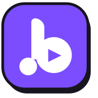

<div align="center">



# Baaja (बाजा)

### An ad-free YouTube Music client for Android, with a bold, playful design

[](https://github.com/harshaltiwari47-dot/Baaja/releases)
[](LICENSE)

[**Download**](#download) · [**Features**](#features) · [**Build**](#build-from-source) · [**Credits**](#credits) · [**License**](#license)

</div>

---

Baaja is a free and open-source YouTube Music client for Android. It's a fork of [Metrolist](https://github.com/MetrolistGroup/Metrolist), keeping everything that makes Metrolist great and giving it a new identity: a light design with bold ink outlines, offset shadows and a purple accent.

> [!WARNING]
> **Regional restriction:** if YouTube Music isn't available in your region, Baaja won't work without a VPN or proxy that connects through a supported region.

## Download

Get the latest APK from the [**Releases page**](https://github.com/harshaltiwari47-dot/Baaja/releases).

| File | For |
|---|---|
| `Baaja.apk` | Most people. Fully open source, with built-in update checks. |
| `Baaja-with-Google-Cast.apk` | Adds casting to Chromecast and Google TV (uses Google Play services). |
| `Baaja-izzy.apk` | The IzzyOnDroid build, with in-app update checks turned off. |

Baaja installs as its own app (`com.baaja.music`), so it can sit alongside Metrolist.

## Features

**Playback & audio**
- Stream any song or video from YouTube Music, with background playback
- Download and cache for offline listening
- Equalizer, audio normalization, crossfade, skip silence, tempo and pitch control
- Sleep timer

**Lyrics & discovery**
- Live synced lyrics, with AI-powered translation
- Personalised quick picks and mixes
- Search songs, albums, artists, videos and playlists
- Identify music playing around you

**Library & account**
- Sign in with your YouTube Music account and sync your library
- Local playlists, playlist import, and drag-to-reorder queues

**Social**
- Listen together with friends in real time
- Last.fm scrobbling and Discord Rich Presence

**Design**
- Baaja's own look: white surfaces, ink outlines, offset shadows and a purple accent
- Floating navigation bar and outlined mini player
- Album-art colours tint the app while music plays
- Light, dark and pure-black modes, plus preset colour palettes
- Home-screen widgets

## Build from source

You need JDK 21 and the Android SDK (platform 37).

```bash
git clone https://github.com/harshaltiwari47-dot/Baaja.git
cd Baaja
./gradlew :app:assembleFossDebug
```

The APK is written to `app/build/outputs/apk/foss/debug/`.

### Publishing a release

Releases are built and published by GitHub Actions (`.github/workflows/release.yml`) when `versionName` in `app/build.gradle.kts` changes on `main`, or when you run the workflow manually. Before the first release, add these **repository secrets** (Settings → Secrets and variables → Actions):

| Secret | What it is |
|---|---|
| `KEYSTORE` | Your release keystore, base64-encoded |
| `KEY_ALIAS` | The key alias inside that keystore |
| `KEYSTORE_PASSWORD` | The keystore password |
| `KEY_PASSWORD` | The key password |
| `DEBUG_KEYSTORE` | A debug keystore, base64-encoded (used by the nightly build) |
| `LASTFM_API_KEY`, `LASTFM_SECRET` | Optional: your own Last.fm API credentials |

Add a `---vX.Y.Z` section to `changelog.md` for each release; the workflow uses it for the release notes. Keep your release keystore backed up: Android only accepts updates signed with the same key.

## Credits

Baaja exists thanks to the open-source projects it's built on.

- **[Metrolist](https://github.com/MetrolistGroup/Metrolist):** Baaja's foundation, by [Mo Agamy](https://github.com/mostafaalagamy) and the [Metrolist contributors](https://github.com/MetrolistGroup/Metrolist/graphs/contributors). Almost everything Baaja does, Metrolist built first.
- **[InnerTune](https://github.com/z-huang/InnerTune)** by Zion Huang and Malopieds, and **[OuterTune](https://github.com/DD3Boh/OuterTune)** by Davide Garberi and Michael Zh: the projects Metrolist grew from.
- Libraries and services inherited from Metrolist: [Better Lyrics](https://better-lyrics.boidu.dev) (word-synced lyrics), [metroserver](https://github.com/MetrolistGroup/metroserver) (listen-together backend), [MusicRecognizer](https://github.com/aleksey-saenko/MusicRecognizer) (music recognition) and [zemer-cipher](https://github.com/ZemerTeam/zemer-cipher) (YouTube cipher and PoToken).
- Design and feature ideas were also inspired by [SimpMusic](https://github.com/maxrave-dev/SimpMusic), [Echo Music](https://github.com/EchoMusicApp/Echo-Music) and [BitChord](https://github.com/kushagrasinghx/BitChord).

## License

Baaja is licensed under the **GNU General Public License v3.0**, the same licence as Metrolist. See [LICENSE](LICENSE). The commit history shows exactly what Baaja changed on top of Metrolist.

## Disclaimer

This project is **not affiliated with, funded, authorized, endorsed by, or in any way associated** with YouTube, Google LLC, Metrolist Group LLC, or any of their affiliates and subsidiaries. All trademarks, service marks and other intellectual property referenced here belong to their respective owners.
